# Connecting Without WiFi (USB or Ad-Hoc)

Sometimes you can't (or don't want to) put your Mac and tablet on the same WiFi
network — you're at a venue, a practice space, or you simply want the rock-solid
reliability of a cable. Knobbler works in these situations too.

There are three approaches, in rough order of convenience:

- A **direct [USB connection](#usb-connection-recommended)** — plug in a cable
  and tap your computer in the app, just like on WiFi. Works for an iPad or
  iPhone with a **Mac**, and for an Android tablet or phone with a **Windows**
  computer.
- A **[phone hotspot](#phone-hotspot)** — tether both the computer and the tablet
  to your phone's Personal Hotspot. Zero config, auto-discovery still works, and
  it travels anywhere.
- An **[ad-hoc WiFi network](#ad-hoc-wifi-network)** created on the Mac — wireless
  with no router, but the most setup.

## USB Connection (recommended)

A cable is the most reliable link you can give Knobbler: no radio, no router, and
no WiFi dropouts while you record automation. Since app version 2026.10.21 it is
also as easy as WiFi. The computer shows up in the app's **Setup** page a second
time, marked **USB**, and one tap connects through the cable. No IP addresses to
look up.

**Which combinations work:**

| Tablet / phone | Computer | Over USB |
| -------------- | -------- | -------- |
| iPad / iPhone  | Mac      | Yes      |
| Android        | Windows  | Yes      |
| iPad / iPhone  | Windows  | No — use WiFi |
| Android        | Mac      | No — use WiFi |

The cable only carries a network when both ends speak the same kind of USB
networking. Android's USB tethering uses a protocol (RNDIS) that Windows supports
and macOS does not, and Apple devices network over USB only with a Mac.

### iPad or iPhone with a Mac

Requires iOS 17 or newer. Works with both USB-C and Lightning devices.

1. Add Knobbler to your Live Set, and connect the iPad or iPhone to the Mac with
   a USB cable.
2. Open the Knobbler app and go to **Setup**. Your Mac appears under
   **Available devices** a second time, marked **USB**. (If the Mac is also on
   WiFi, you'll see both rows.)

   > **Note:** after plugging in, it can take up to 30 seconds for the two
   > devices to set up the cable's network. If the USB row isn't there yet, give
   > it a moment.

3. Tap the **USB** row. That's it.

If the USB row never appears, try a different cable: some USB-C cables carry
power only, not data.

### Android with a Windows computer

Requires Android 14 or newer.

1. Add Knobbler to your Live Set, and connect the tablet or phone to the Windows
   computer with a USB cable.
2. On the tablet, turn on **USB tethering**: **Settings → Connections → Mobile
   Hotspot and Tethering → USB tethering** (the exact path varies a little by
   manufacturer).
   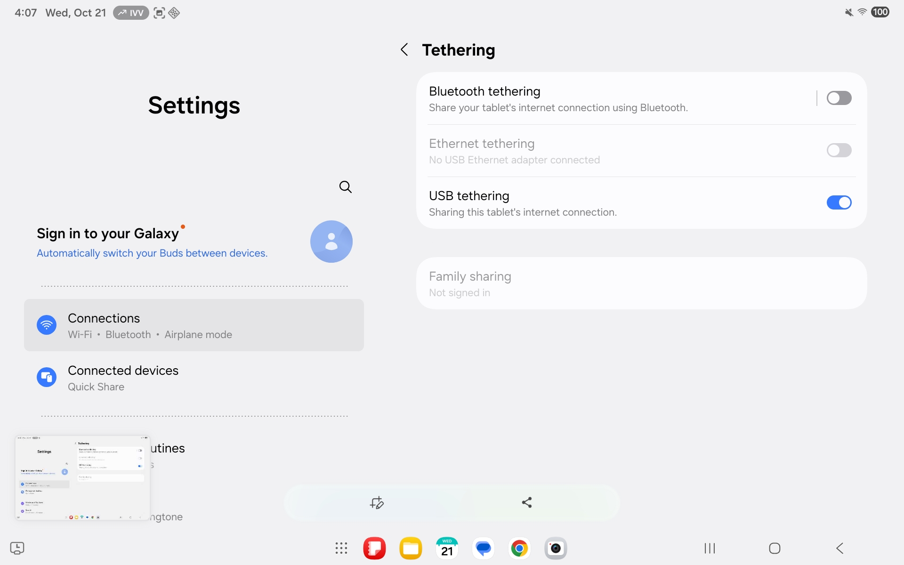

   > **Note:** Android turns USB tethering off whenever the cable is unplugged,
   > so switch it back on each time you plug in.

3. Open the Knobbler app and go to **Setup**. Your computer appears under
   **Available devices** a second time, marked **USB**. Tap it.

If the USB row never appears, try a different cable: some USB-C cables carry
power only, not data.

**If the USB row appears but connecting fails with "No response",** Windows
Firewall is blocking Ableton Live on the cable. Windows treats every USB tether as
a new **Public** network, while Live is usually allowed only on **Private**
networks (that's the box Windows suggests the first time Live goes online). To fix
it once and for all:

1. Open **Windows Security → Firewall & network protection → Allow an app
   through firewall**.
2. Click **Change settings** (the checkboxes are greyed out until you do), find
   **Ableton Live** in the list, and tick **Public** as well as **Private**.
   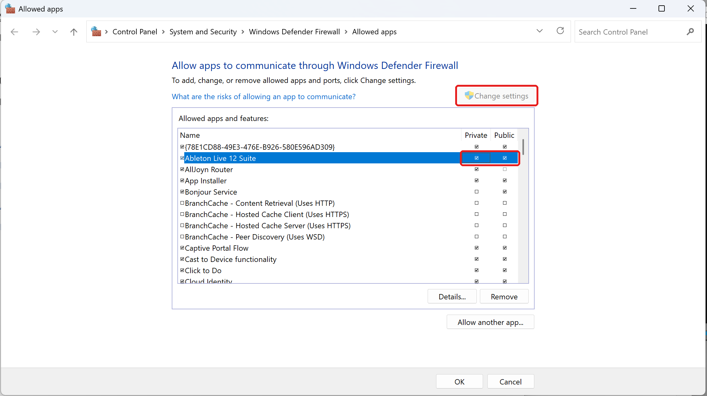
3. Click **OK**, then tap the USB row again.

This also lets Live accept connections on genuinely public networks, such as café
WiFi. If you'd rather not allow that, the alternative is to mark the tether's
network **Private** in **Settings → Network & internet → Ethernet** each time you
plug in.

## Phone Hotspot

If you have a phone with you, the simplest no-router option is to tether **both**
your Mac and your tablet to the phone's **Personal Hotspot**. The hotspot puts both
devices on the same private network and routes traffic between them — including the
multicast discovery messages Knobbler uses — so this behaves just like a normal
WiFi network. **Auto-discovery works, and there are no IP addresses to type in.**

1. Turn on **Personal Hotspot** on your phone (on iPhone: **Settings → Personal
   Hotspot → Allow Others to Join**).

2. Join that hotspot from **both** the Mac (WiFi menu → your phone's name) and the
   tablet (**Settings → WiFi → your phone's name**).

3. Add Knobbler to your Live Set, open the Knobbler app on the tablet, and go to
   the **Setup** page. It scans for and finds the device on the Mac automatically —
   select your Mac under **"Found These Knobblers"** and you're connected.

> **Tip:** this works without any cellular data plan or signal — the phone is just
> acting as a local router between your two devices, so nothing actually needs to
> reach the Internet. It's a great fallback at venues with no usable WiFi.

> **If discovery comes up empty:** a few phone-hotspot configurations isolate the
> connected devices from each other, so the Mac and tablet can't see one another
> even though both are online. If the scan finds nothing, just fall back to the
> [manual-IP method](#manual-usb-setup-older-app-versions) — read each device's
> hotspot IP and type them in by hand, exactly like the manual USB setup below.

## Manual USB Setup (older app versions)

App versions before 2026.10.21 don't discover computers over USB, so with an iPad
or iPhone and a Mac you fill in the two IP addresses by hand. Connecting the cable
creates a private `169.254.x.x` ("link-local") network between the two devices.

1. Connect the iPad or iPhone to the Mac with a USB cable.

   > **Note:** after plugging in the cable, it can take up to 30 seconds for the
   > computer to negotiate the link-local network and assign the IP addresses. If
   > the addresses below don't appear right away, wait a moment and check again.

2. **Find the tablet's address.** Open the Knobbler app and go to
   **Setup → Connection**. The app displays its own `169.254.x.x` address at the
   top of the panel, labeled **"This device:"**.
   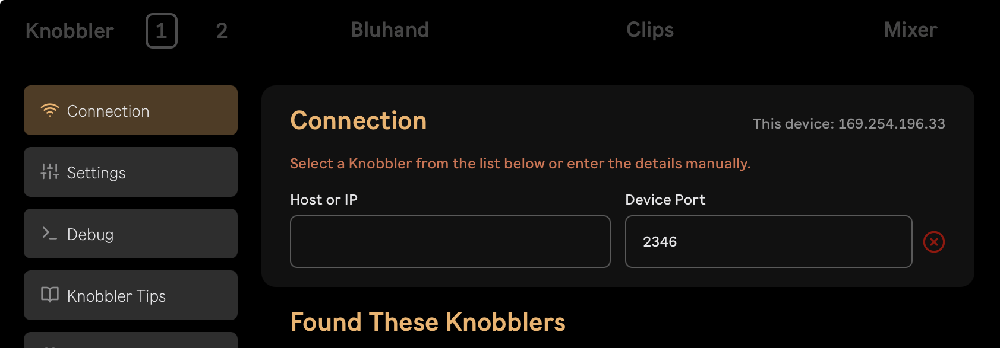

3. **Point the Live device at the tablet.** In the Knobbler4 device in Ableton
   Live, type the tablet's address (from step 2) into the **Hostname or IP** box,
   and set **App Port** to **2347**. (Leave the device's own **Device Port** at
   **2346**.)
   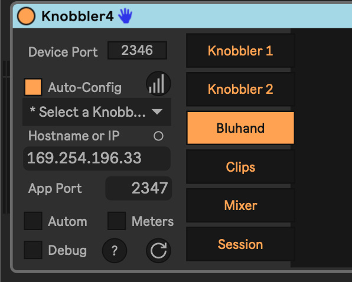

4. **Find the Mac's address.** Open Terminal on the Mac and run:

   ```
   ifconfig -a | grep 169.254
   ```

   Note the `169.254.x.x` address it prints (the value after `inet`).
   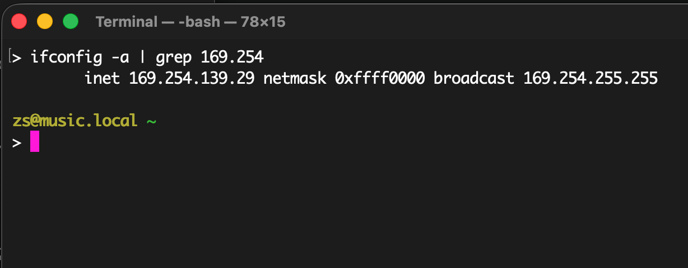

5. **Point the app at the Mac.** In the Knobbler app, type the Mac's address (from
   step 4) into the **Host or IP** box. Leave the device port at its default,
   **2346**.

6. Press **Test** in the app to exercise the connection. A green **Connected**
   banner confirms the link is working.
   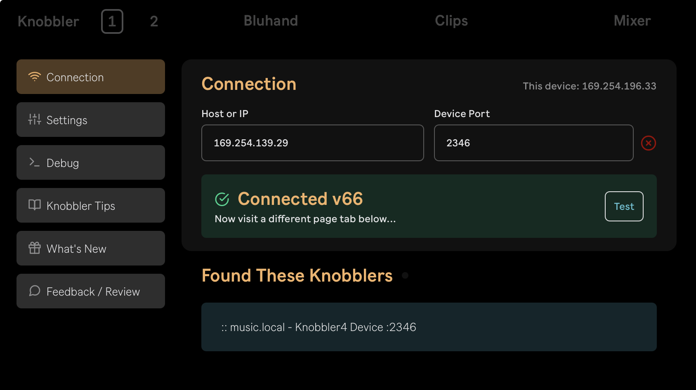

At this point Knobbler should be fully functional over the USB cable.

> **Tip:** the two ports are not the same on purpose — the Live device sends to the
> tablet on **2347**, and the tablet sends to the device on **2346** (the default).
> If Test fails, double-check that you didn't swap the two addresses or ports.

## Ad-Hoc WiFi Network

If you'd rather connect wirelessly but there's no WiFi network to join, you can
create an ad-hoc WiFi network on your Mac that your iPad can join.

These instructions are Mac-specific. If you have a Windows machine and can
contribute instructions, please [let me know](mailto:zack@steinkamp.us).

> (originally from [this post on Mac StackExchange](https://apple.stackexchange.com/questions/464557/how-to-create-computer-to-computer-network-on-macos-sonoma-2023).)

1. Run the following commands, one-by-one in Terminal:

   ```
   sudo networksetup -createnetworkservice AdHoc lo0
   sudo networksetup -setmanual AdHoc 192.168.1.88 255.255.255.255
   sudo networksetup -setmanual AdHoc 127.0.0.1 255.255.255.255
   ```

2. Configure sharing settings:

   - Open System Settings
   - Navigate to Sharing
   - Select Internet Sharing (i)
   - Set "Share connection from" to "AdHoc"
   - Set "To devices using" to "Wifi"
     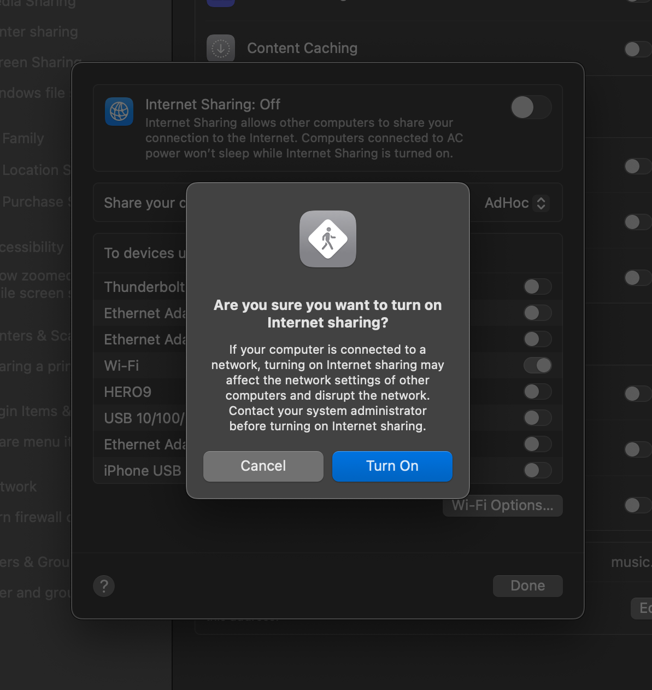
   - Configure the new WiFi network with a name, channel, and password
     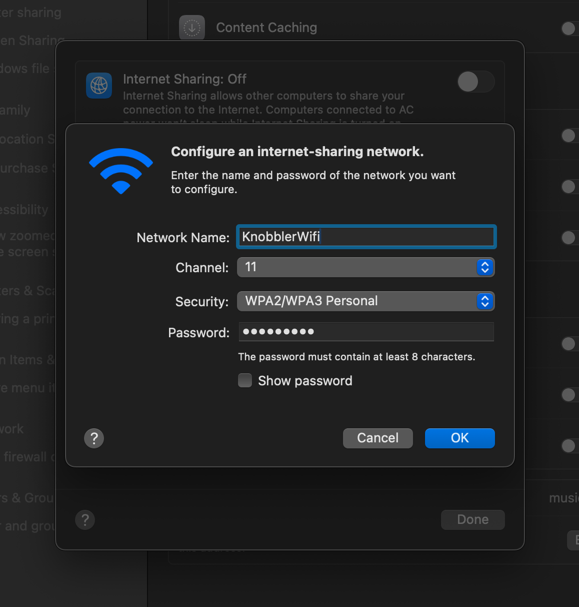
   - Ensure Internet Sharing is switched On
     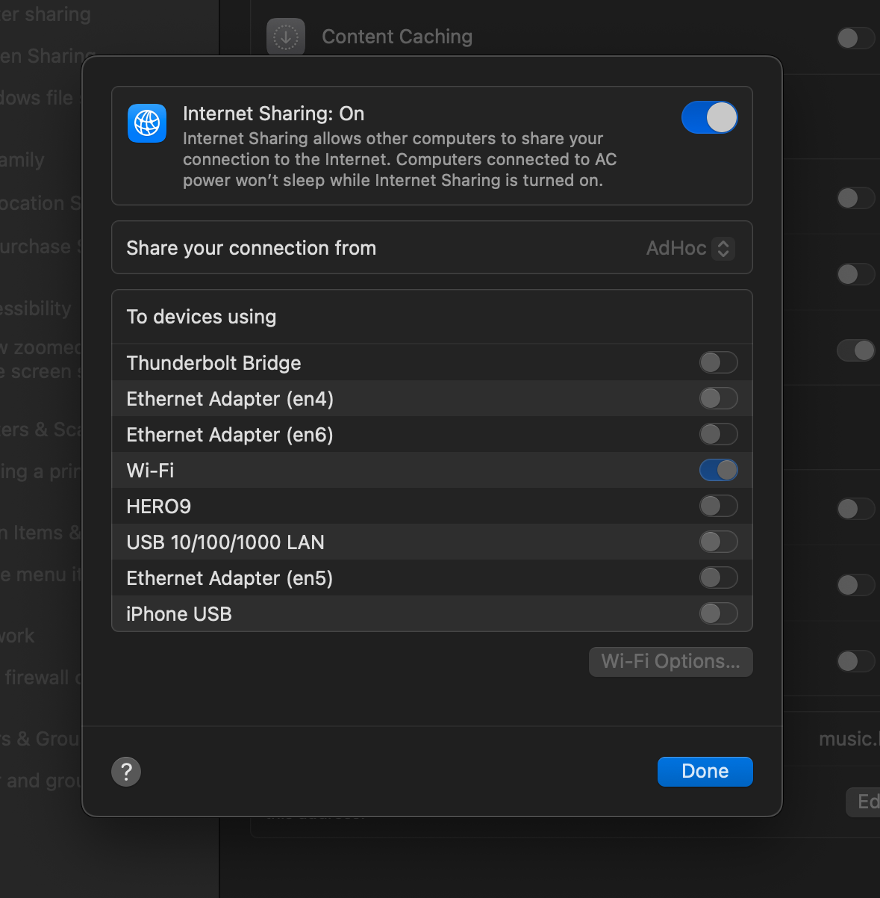

3. Join the WiFi network you just created on your iPad
   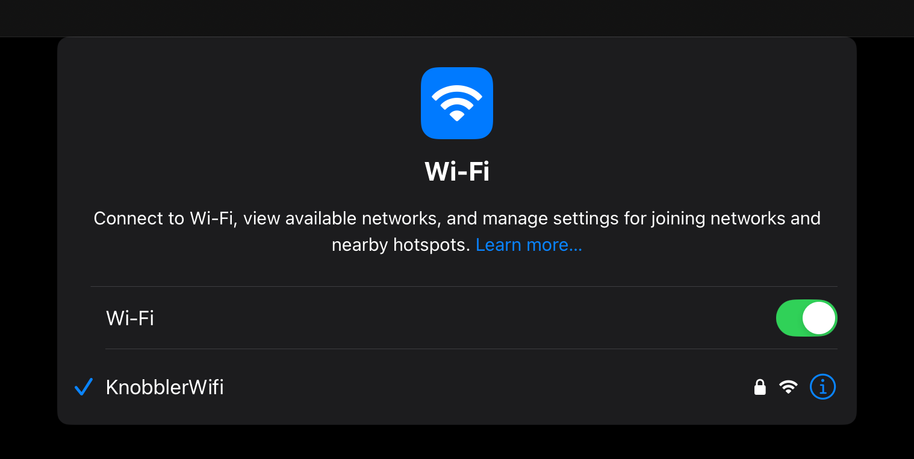

4. Tap the (i) icon next to the WiFi connection on your iPad and note the iPad's IP address. In the screenshot below, it is `192.168.2.4`
   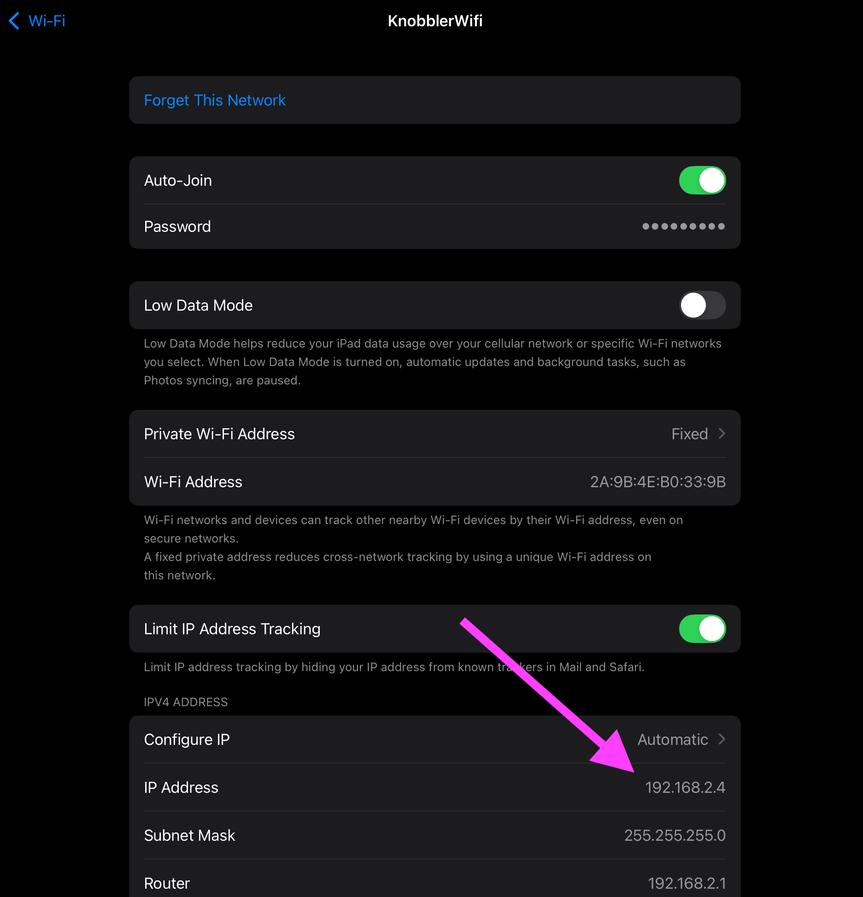

5. Add Knobbler to your Live Set and manually fill in the iPad's IP address.
   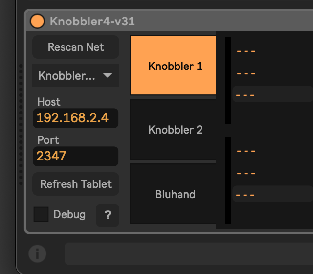

6. Open the Knobbler app on the iPad and go to the Setup page. It should scan for and detect the device on the Mac.
   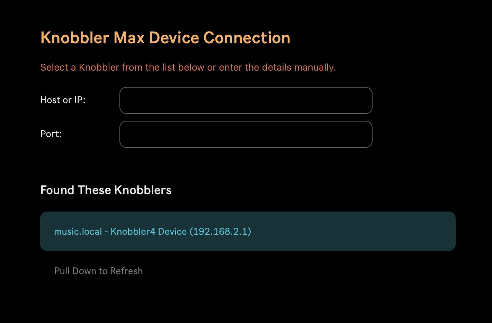

7. Select your Mac in the "Found These Knobblers" section. You should get a "Connection Successful!" message.
   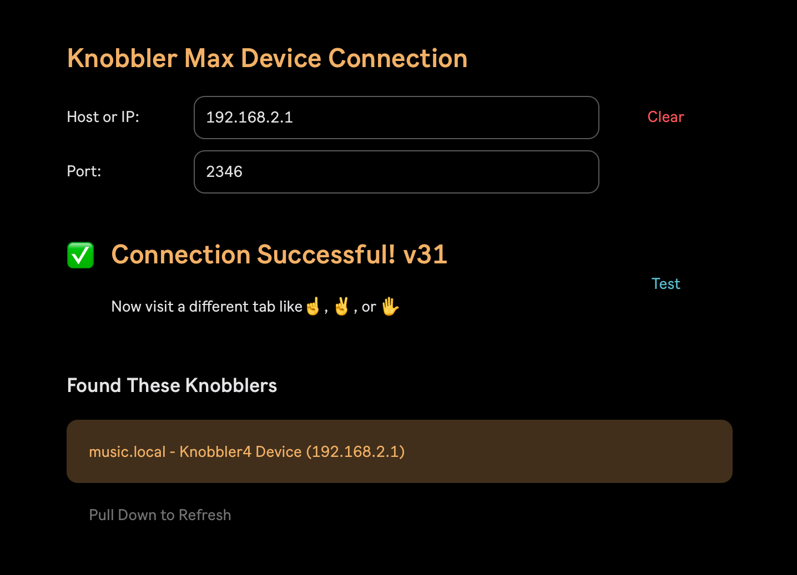
</content>
</invoke>
